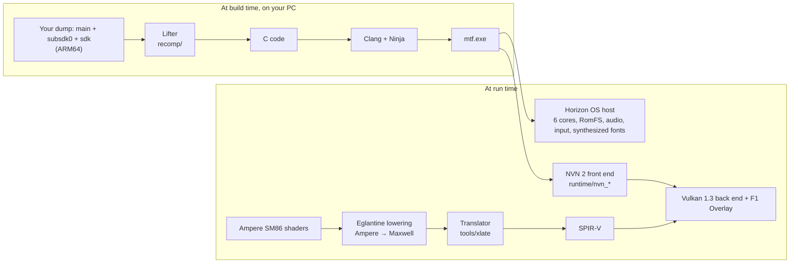

# MTF ShadowRacket

[](LICENSE)
[](https://github.com/STS78721/MTF-ShadowRacket/actions/workflows/content-guard.yml)
[](https://github.com/STS78721/MTF-ShadowRacket/stargazers)
[](https://github.com/STS78721/MTF-ShadowRacket/issues?q=is%3Aopen+label%3A%22help+wanted%22)
[](https://github.com/STS78721/MTF-ShadowRacket/discussions)

**MTF ShadowRacket** is a static recompilation of *Mario Tennis Fever* (Nintendo Switch 2, Title ID `0400D4201C6EA000`) into a native Windows x86-64 application with a Vulkan 1.3 renderer. There is no CPU interpreter or JIT at run time: `main`, `subsdk0`, and `sdk` are lifted from ARM64 to C ahead of time and compiled into a single native executable (`mtf.exe`), backed by the Universal NS2 Horizon OS runtime, NVN 2 front end, Ampere SM86 shader lowering, and an in-game Dear ImGui overlay (`F1` / `Back+Y`).

> [!IMPORTANT]
> **No game files or cryptographic keys are included, and none ever will be.** You need your own copy of *Mario Tennis Fever*, dumped from your own console. Instructions for obtaining those files will not be provided, and there are no downloadable game builds: everyone compiles locally from their own dump.

## Status

**In-game & Playable (Alpha).** Boots cleanly through video intros, menus, Academy/Practice drills, and 3D court matches at 60 FPS with multi-core Horizon synchronization, audio, controller rumble, synthesized Switch button glyph prompts (no firmware font dump required), deferred court lighting, and live 1x–4K/8K resolution scaling.

| Phase | | State |
| --- | --- | --- |
| F0 CPU | ✅ | `main`, `subsdk0`, and `sdk` lift cleanly to C (`ARMv8.3` PAC, `LDAPR`, `TLSDESC`, and multi-module relocation tables). |
| F1 OS | ✅ | 6-core Horizon runtime with asynchronous preemption, RomFS (`MountRom` / packed image), saves, audio (`nn::audio`), vibration, VP9 `nn::movie` events, and clean-room synthesized `FontNintendoExtended` Switch button prompts (`U+E0A0..U+E12C`). |
| F2 NVN 2 | ✅ | NVN 55 inline fastpath buffer layout, `DirtyTileMap` & `MultiDrawElementsIndirectCount` deferred court lighting, command memory callbacks, indexed quad conversion, and GPU compute block-linear GOB deswizzle. |
| F3 Shaders | ✅ | Ampere SM86 shaders lower through Eglantine (`TEX`/`TXD`/`TXQ`/`ISBERD`/`LEA`/`ALD.O`/`I2F` fixes + guarded SSBO loads) and NativeAOT `xlate` to SPIR-V. |
| F4 Vulkan | ✅ | Vulkan 1.3 back end with VMA pooling, graphics pipeline libraries, UBO submission snapshots, 1x–4K/8K scaling, FSR/FXAA/SMAA, and the Midnight Glass live overlay (`F1`). |
| F5 Playable | 🚧 | Playable in Practice and Court matches at 60 FPS; ongoing polish for edge-case lighting, additional modes, and cross-GPU testing. |

## How it works



Longer technical details are in [docs/architecture.md](docs/architecture.md), [docs/bananza-shaders.md](docs/bananza-shaders.md), and [docs/UNIVERSAL_NS2_TO_PC_PLAYBOOK.md](docs/UNIVERSAL_NS2_TO_PC_PLAYBOOK.md).

## Building from source

Requires Windows x64, MSYS2 UCRT64 (`clang`, `lld`, `ninja`), Python 3.10+, and the .NET 8 SDK (to build the NativeAOT SPIR-V shader translator once).

With `exefs/` and `romfs/` from your own *Mario Tennis Fever* v1.1.1 dump:

```powershell
$env:PATH = "C:\msys64\ucrt64\bin;$env:PATH"

# 1. Build the NativeAOT shader translator once
.venv\Scripts\python tools\build_xlate.py

# 2. (Optional) Pre-flight scan your dump (relocations, imports, SM86 shaders, NVN2 procs)
.venv\Scripts\python tools\universal_ns2_to_pc.py scan --exefs "C:\Games\MTF PC\exefs" --romfs "C:\Games\MTF PC\romfs"

# 3. Lift ARM64 (main, subsdk0, sdk) -> C
.venv\Scripts\python tools\universal_ns2_to_pc.py init --ver mtf111 --short mtf --name "Mario Tennis Fever" --exefs "C:\Games\MTF PC\exefs" --romfs "C:\Games\MTF PC\romfs"

# 4. Compile & link native mtf.exe
.venv\Scripts\python tools\universal_ns2_to_pc.py build --ver mtf111 --exefs "C:\Games\MTF PC\exefs" --romfs "C:\Games\MTF PC\romfs"
```

Copy `mtf.ini.example` next to `build\mtf111\mtf.exe` as `mtf.ini` to customize resolution scaling, fullscreen, VSync/FPS cap, and input bindings, or press **`F1`** (or **`Back + Y`** on controller) in-game to open the live configuration overlay.

Everything generated or compiled stays under `build\` and `generated\`, which git ignores. Runtime logs are written to `build\mtf111\logs\mtf.log`.

## Contributing & Content Guard

Before opening a pull request, read [CONTRIBUTING.md](CONTRIBUTING.md). Nothing from the game (binaries, assets, shaders, font dumps, or keys) may ever enter the repository, issues, or pull requests. Always run:

```powershell
.venv\Scripts\python tools\check_content.py
```

before committing; GitHub Actions runs the same check on every push and pull request. Questions and hardware test reports are welcome in [Discussions](https://github.com/STS78721/MTF-ShadowRacket/discussions) and [Issues](https://github.com/STS78721/MTF-ShadowRacket/issues). Everyone participating follows the [Code of Conduct](CODE_OF_CONDUCT.md).

## FAQ

**Can I play it?** Yes — Practice drills and Court matches run natively at 60 FPS with sound, controller prompts, and high-resolution scaling, while visual and mode-specific polish continues.

**Do I need dumped Switch firmware fonts for button icons?** No. The runtime synthesizes a clean-room TrueType `FontNintendoExtended` (`ov_pl_ext_font.h`) at startup for Nintendo's Private Use Area controller glyphs (`A`/`B`/`X`/`Y`, `L`/`R`/`ZL`/`ZR`, `+`/`-`, sticks, and directional 4-dot prompts).

**Which version of the game?** *Mario Tennis Fever* v1.1.1 (Title ID `0400D4201C6EA000`).

**Why GPL?** The Ampere shader lowering in `runtime/third_party/eglantine/` derives from Eglantine (Eden Emulator Project) under GPLv3. Files originating from TotK Recomp retain their [MIT License](LICENSE-MIT).

## Credits, Acknowledgments & Special Thanks

**MTF ShadowRacket** stands on the shoulders of the static recompilation, GPU translation, and Switch / Switch 2 research communities:

### Static Recompilation Foundations
- **[TotK Recomp](https://github.com/valentderah/totk-pc-recomp)** by **valentderah** and contributors: Architectural foundation for the ahead-of-time ARM64-to-C lifter, Horizon OS host runtime, Unicorn differential tests, and Vulkan execution engine.
- **[DKB Recomp](https://github.com/Lucas-blip-png/dkb-pc-recomp)** by **Lucas-blip-png**, **[sagaopc](https://github.com/sagaopc/dkb-pc-recomp)**, and **[sostenesfreitas](https://github.com/sostenesfreitas/dkb-pc-recomp)**: Pioneering Switch 2 NVN 2 entry points, `nn::codec` support, and Ampere shader lowering integration.
- **[MKW-THWOMP](https://github.com/STS78721/MKW-THWOMP)** by **STS78721**: Multi-module Switch 2 static recompilation research, 6-core thread synchronization, resolution scaling, and Vulkan shader pipeline work.
- **[Hookshot](https://github.com/NotRexed)** by **NotRexed**: Rapid Switch 2 bring-up methodology, shader census tooling, NVN proc auditing, and `lower_test`.
- **[LAS Recomp](https://github.com/peiikai/LASRecomp)** by **peiikai**, **[MacNativeGames](https://github.com/ly05010419/MacNativeGames)** by **ly05010419**, **[SavageWindRecomp](https://github.com/Revivedx/SavageWindRecomp)** by **Revivedx**, and **[nxnative](https://github.com/seedds/nxnative)** by **seedds**.

### Switch 2 GPU, Shader Translation & Emulation Research
- **[Eglantine](https://git.eden-emu.dev/Franseven/PokeDinner-a-Eglantine-Fork)** (Eden Emulator Project) by **Franseven** & **[notsapinho/Eglantine](https://github.com/notsapinho/Eglantine)**: Ampere-to-Maxwell SM86 lowering, bindless/SSBO fixes, and Switch 2 GPU reverse engineering.
- **[Fritchii](https://github.com/Frizti/Fritchii)**, **[Lichii](https://github.com/zortos293/Lichii)**, and **[Lichii-fg](https://github.com/cirnoice9/Lichii-fg)**: Switch 2 NVN2 display/service research and Vulkan robustness insights.
- **[Mesa NAK](https://gitlab.freedesktop.org/mesa/mesa)** by **Faith Ekstrand** and Collabora, **[Ryujinx](https://github.com/Ryujinx/Ryujinx)** Team, and **[deko3d](https://github.com/devkitPro/deko3d)** by **FinCS** / **devkitPro**.

### Horizon OS & Open-Source Libraries
- **[hactool](https://github.com/SciresM/hactool)** & **Atmosphère** by **SciresM** and Reswitched, plus **[Switchbrew](https://switchbrew.org)**.
- **Vulkan 1.3** (Khronos Group), **SDL3**, **Vulkan Memory Allocator (VMA)**, **Dear ImGui**, **libvpx**, **libopus**, and **Zstandard (zstd)**.

## License

MTF ShadowRacket as a whole is licensed under the [GNU GPL v3 or later](LICENSE). Files inherited from TotK Recomp retain their [MIT License](LICENSE-MIT); third-party libraries keep their own licenses ([THIRD_PARTY_NOTICES.md](THIRD_PARTY_NOTICES.md)). Independent, non-commercial research project, not affiliated with or endorsed by Nintendo.
