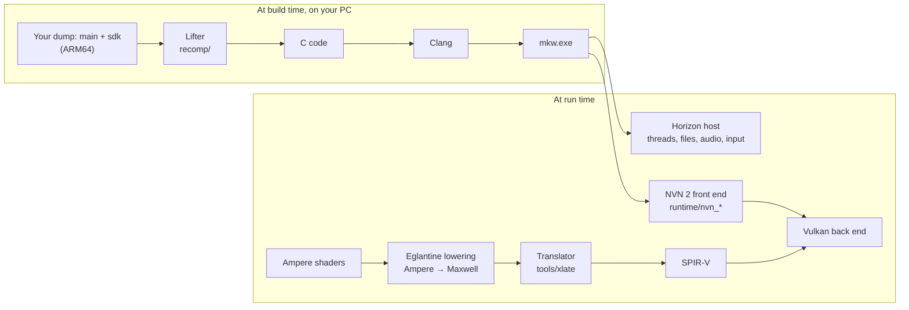

# MKW Recomp

[](LICENSE)
[](https://github.com/STS78721/MKW-THWOMP/actions/workflows/content-guard.yml)
[](https://github.com/STS78721/MKW-THWOMP/stargazers)
[](https://github.com/STS78721/MKW-THWOMP/issues?q=is%3Aopen+label%3A%22help+wanted%22)
[](https://github.com/STS78721/MKW-THWOMP/discussions)

**MKW Recomp** is a static recompilation of *Mario Kart World* (Nintendo Switch 2, 2025) into a native Windows
x86-64 application with a Vulkan renderer. There is no emulator at run time: the game's ARM64 code is translated to C
ahead of time and compiled into one executable, and its graphics calls are answered by a host implementation of
NVN 2. It is built on [TotK Recomp](https://github.com/valentderah/totk-pc-recomp) and the [DKB Recomp](https://github.com/sagaopc/dkb-pc-recomp) Switch 2 work.

As far as we know, this is the first public static recompilation of Mario Kart World.

> [!IMPORTANT]
> **No game files are included, and none ever will be.** You need your own copy of *Mario Kart World*, dumped
> from your own console. Instructions for obtaining those files will not be provided. There are no downloadable
> builds: everyone builds from their own dump.

## Status

**Not playable yet.** The game boots, initializes Horizon OS services, advances through the intro sequence, renders
3D graphics with Ampere shaders lowered to Maxwell SPIR-V, but has graphical issues (lighting/textures and render pipeline).

| Phase | | State |
| --- | --- | --- |
| F0 CPU | ✅ | `main` and `sdk` lift with no unsupported instruction (ARMv8.3 pointer authentication and `LDAPR` added). All functions translate cleanly to C. |
| F1 OS | ✅ | Boots on Horizon host with Switch 2 differences: RomFS, save, audio, controller, system memory mapping. |
| F2 NVN 2 | ✅ | NVN 2 entry points answered; the game loop runs. Command buffer calls accepted and executed. |
| F3 Shaders | ✅ | Ampere shader stages go through Ampere-to-Maxwell lowering (`ISBERD`, `ISBEWR`, `SUST.D.2D` extended support) and translator to SPIR-V. |
| F4 Vulkan | ✅ | The intro and 3D scenes render. Massive 8K ASTC texture arrays auto-fallback to BC3 compression to fit within VRAM. |
| F5 Playable | 🚧 | In progress: Graphical issues, track lighting, in-race physics and gameplay controls. |

## How it works



The longer version is in [docs/architecture.md](docs/architecture.md) (shared with TotK Recomp) and
[docs/bananza-shaders.md](docs/bananza-shaders.md) (the NVN 2 shader work).

## How to help

Each open problem is a separate, well-bounded job with its own issue. Pick one, say in the issue that you are on it,
and keep each pull request to one topic.

**No code needed**, only your PC and your own copy of the game:

- **Test on your GPU.** Runs on AMD, Intel and different NVIDIA cards, with logs, show what breaks there.
- **Graphical issue debugging**: Report visual differences, missing render targets, or shader issues with log output.

**Code** ([help wanted](https://github.com/STS78721/MKW-THWOMP/issues?q=is%3Aopen+label%3A%22help+wanted%22)):

- **Texture & lighting shaders**: Investigate remaining black surfaces and material render states.
- **NVN 2 entry points**: Complete recording of new Switch 2 NVN 2 command buffer calls.

Your first contribution, step by step:

1. Build from your own dump ([Building from source](#building-from-source)).
2. Run it and note how far it gets on your machine.
3. Report your findings in Issues or Discussions.

Before you open a pull request, read [CONTRIBUTING.md](CONTRIBUTING.md). Its hard rule: nothing that came out of the
game goes into the repository, not in commits, issues or pull requests. Run `python tools/check_content.py --staged`
before committing; CI runs the same check. Questions go to
[Discussions](https://github.com/STS78721/MKW-THWOMP/discussions). Everyone taking part follows the
[code of conduct](CODE_OF_CONDUCT.md).

## Building from source

The toolchain is based on MSYS2 UCRT64 Clang, Ninja, Python 3.10+ and the .NET SDK for the shader translator. With the ExeFS and RomFS from your own dump:

```powershell
.venv\Scripts\python tools\build_xlate.py
.venv\Scripts\python recomp\gen.py --exefs <exefs> --out generated\mkw180 --modules main,subsdk0,subsdk1,sdk
.venv\Scripts\python tools\mkw_expected.py --exefs <exefs> --name mkw180 --display 1.8.0
.venv\Scripts\python tools\mkw_pack_romfs.py --dir <romfs folder> --out build\extracted\mkw180\romfs
.venv\Scripts\python tools\build_game.py --version mkw180 --expected tools\data\expected-mkw180.json --exefs <exefs> --romfs build\extracted\mkw180\romfs
```

Everything the build writes stays under `build\` and `generated\`, which git ignores. Running and testing logs are stored in `logs/mkw.log`.

## FAQ

**Can I play it?** Not yet. The intro renders with graphical issues and work is underway to reach full gameplay. Follow the Issues and Discussions.

**Will there be a download?** No. The executable is made from the game's own code, so it cannot be shared. Everyone
builds it from their own dump.

**Which version of the game?** Base 1.8.0 (Title ID `0400C3F00006E000`).

**Linux?** The recompilation toolchain supports Linux; testing on Linux with native Vulkan is welcome.

**Why GPL?** The shader lowering comes from Eglantine (Eden Emulator Project), which is GPL. Files that came from TotK
Recomp keep their MIT terms.

**How is AI used?** Portions of the code and documentation are written with AI coding assistance, as in TotK
Recomp, and checked by running the game and tests. AI-assisted pull requests are welcome; you are
responsible for having read and run them.

## Credits, Acknowledgments & Special Thanks

**MKW Recomp** stands on the shoulders of giants in the emulation, static recompilation, and graphics research communities. Without their years of groundbreaking work, reverse engineering, and open-source contributions, a native PC recompilation of *Mario Kart World* would not exist.

### Static Recompilation Foundations
- **[TotK Recomp](https://github.com/valentderah/totk-pc-recomp)** by **valentderah** and its contributors: The direct architectural foundation of this project—providing the ahead-of-time ARM64-to-C lifter, the native Horizon OS runtime environment, differential Unicorn testing, and Vulkan execution engine.
- **[DKB Recomp](https://github.com/Lucas-blip-png/dkb-pc-recomp)** by **Lucas-blip-png**, **[sagaopc](https://github.com/sagaopc/dkb-pc-recomp)**, and **[sostenesfreitas](https://github.com/sostenesfreitas/dkb-pc-recomp)**: The pioneers of Nintendo Switch 2 static recompilation on PC—answering hundreds of Switch 2 NVN 2 API entry points, integrating Ampere lowering, and proving that Switch 2 titles can run natively on modern PC hardware.
- **[LAS Recomp](https://github.com/peiikai/LASRecomp)** by **peiikai**: Foundational work in AArch64 function lifting, SIMD/FP translation, and Vulkan format bindings.
- **[MacNativeGames](https://github.com/ly05010419/MacNativeGames)** by **ly05010419**: Essential Horizon runtime implementation, audio renderer, NPDM loader, and dynamic link mechanisms.
- **[SavageWindRecomp](https://github.com/Revivedx/SavageWindRecomp)** by **Revivedx**: Early Switch recompilation research and Vulkan runtime optimizations.
- **[nxnative](https://github.com/seedds/nxnative)** by **seedds**: Early native Horizon execution groundwork.

### GPU, Shader Translation & Emulation Research
- **[Eglantine](https://git.eden-emu.dev/Franseven/PokeDinner-a-Eglantine-Fork)** (Eden Emulator Project) by **Franseven**: The indispensable Ampere-to-Maxwell shader lowering implementation and Switch 2 GPU architectural reverse engineering.
- **[Mesa NAK](https://gitlab.freedesktop.org/mesa/mesa)** by **Faith Ekstrand** and Collabora: The open-source SM70+ (Volta/Turing/Ampere) instruction encodings that power our shader lowering pipelines.
- **[Ryujinx](https://github.com/Ryujinx/Ryujinx)** Team: The industry-standard GPU shader translator and SPIR-V emitter architecture.
- **[deko3d](https://github.com/devkitPro/deko3d)** by **FinCS** and the **[devkitPro](https://devkitpro.org)** team: Low-level NVN hardware documentation and register definitions.

### Horizon OS, File Formats & Research
- **[hactool](https://github.com/SciresM/hactool)** & **Atmosphère** by **SciresM** and the Reswitched team: Critical file format specifications (ExeFS, RomFS, NPDM, PFS0) and system service documentation.
- **[Switchbrew](https://switchbrew.org)** and the Switch homebrew community: Exhaustive documentation of Horizon OS system calls, IPC protocols, and hardware specifications.

### Libraries & Standards
- **[The Khronos Group](https://www.khronos.org/vulkan/)**: The Vulkan 1.3 graphics API standard.
- **[Simple DirectMedia Layer (SDL3)](https://libsdl.org)** by **Sam Lantinga** and contributors: Cross-platform windowing, high-precision event handling, and audio backends.
- **[Vulkan Memory Allocator (VMA)](https://github.com/GPUOpen-LibrariesAndSDKs/VulkanMemoryAllocator)** by **Adam Sawicki** and **AMD / GPUOpen**: High-performance GPU memory and pool allocation.
- **[libvpx](https://chromium.googlesource.com/webm/libvpx)** by the **WebM Project / Google**: VP9 movie playback and video decoding.
- **[libopus](https://opus-codec.org/)** by the **Xiph.Org Foundation**, Mozilla, and Skype: Audio decoding and streaming.
- **[Zstandard (zstd)](https://github.com/facebook/zstd)** by **Yann Collet** and Meta: Ultra-fast compression and streaming decompression.

### Community & Early Testers
- Special thanks to all early hardware testers running on NVIDIA, AMD, and Intel GPUs, sharing diagnostic logs, identifying shader edge cases, and helping drive this project forward.

## License

MKW Recomp as a whole is under the [GNU GPL v3 or later](LICENSE), because it includes Eglantine's GPL Ampere shader
lowering (`runtime/third_party/eglantine/`). The files that came from TotK Recomp keep their
[MIT License](LICENSE-MIT); third-party code keeps its own license ([THIRD_PARTY_NOTICES.md](THIRD_PARTY_NOTICES.md)).
The license grants nothing for Nintendo's game.

MKW Recomp is an independent, non-commercial fan project, not affiliated with or endorsed by Nintendo. *Mario Kart
World* and *Nintendo Switch 2* are trademarks of Nintendo.
