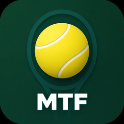
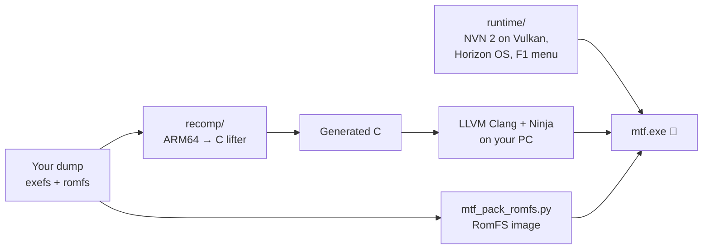

<div align="center">



# 🎾 MTF-ShadowRacket

### Mario Tennis Fever, running natively on Windows PC

*A static recompilation of the Nintendo Switch 2 game, not an emulator.*

[](#-requirements)
[](#-under-the-hood)
[](#-quick-start)
[](https://gitlab.com/steeltemplesaint-recomps/MTF-ShadowRacket/-/releases/Alpha-0.1.0)
[](#-credits--licence)

**[Quick start](#-quick-start)** · **[Features](#-highlights)** · **[Status](#-status)** · **[How it works](#-under-the-hood)** · **[Changelog](CHANGELOG.md)** · **[Credits](#-credits--licence)**

</div>

---

> [!IMPORTANT]
> **No game files are included.** You need your own legally dumped copy of **Mario Tennis Fever (1.1.1)**: `exefs` and `romfs`. This repository contains only the recompiler, the runtime, the launcher, and the setup tools.

> [!NOTE]
> **Current release: `Alpha 0.1.0`.** MTF-ShadowRacket ships on safe zero-config client defaults (`1920x1080` windowed, Original internal resolution, AMD FSR, Frame Generation Off, 60 FPS) so every system boots cleanly — adjust resolution, upscaling, and visual profiles anytime in `MTFLauncher` or in-game (`F1`). Known minor issues remain and will be addressed in upcoming patch updates.

## ✨ Highlights

<table>
<tr>
<td width="50%" valign="top">

### 🚀 Native code, not emulation
Every ARM64 instruction of `rtld`, `main`, `subsdk0`, and `sdk` is translated **ahead of time** into C and compiled natively on your PC into `mtf.exe`. No CPU interpreter runs while you play.

### 🎾 Resolution scaling & FSR
Switch cleanly between **Original (~960p)**, **720p**, **900p**, **1080p**, and **1440p** internal frame resolutions, paired with AMD FSR 1.0, Bilinear scaling, Frame Generation options, and OLED/Clarity colour presets.

### 🎨 Smooth shaders & Story Mode fixes
In-memory prepared shader indexing, bounded pipeline wait budgets, and cached ASTC GPU deswizzle eliminate cutscene hitches and sporadic black-square shadows during Story Mode progression.

</td>
<td width="50%" valign="top">

### 🎮 Switch-2-style settings menu
Press **F1** or **Esc** (or **Back + Y** on a controller) for a native settings overlay in the **Tennis Court** Championship Turf theme (plus Dark and Light themes) with live telemetry and config saving to `mtf.ini`.

### 🖥️ Dedicated Setup Wizard & MTFLauncher
Install cleanly with **SteelTemple MTF-ShadowRacket Setup** (`Full-Setup-Wizard.exe`) or the portable archive: bundled LLVM-MinGW, Ninja, and Python build `mtf.exe` locally from your dump with no external tools required.

### 🕹️ Controllers & saves that stay yours
Works out of the box with Xbox, DualSense, Switch / Switch 2 Pro controllers, and keyboard. Includes mod folder shortcuts and timestamped save backup snapshots inside `MTFLauncher`.

</td>
</tr>
</table>

## 📊 Status

| Area | State |
|---|---|
| Boot, intro movies, menus | ✅ Working |
| Exhibition matches & courts | ✅ Playable (60 fps target) |
| Internal resolution scaling (`original` – `1440p`) | ✅ Working |
| Story Mode & cutscenes | ⚠️ Playable with known minor visual/shadow issues |
| Audio & controller input | ✅ Working |
| Online play | ❌ Not supported, by design |

## 🚀 Quick start

**1. Install MTF-ShadowRacket**

Download the latest **`Alpha 0.1.0`** release from the **[Releases page](https://gitlab.com/steeltemplesaint-recomps/MTF-ShadowRacket/-/releases/Alpha-0.1.0)**:
- Run **`SteelTemple-MTF-ShadowRacket-Alpha-0.1.0-Full-Setup-Wizard.exe`** (no administrator rights needed), or extract **`Portable-StandAlone.zip`**.

**2. Set up from your Mario Tennis Fever 1.1.1 dump**

Open **MTFLauncher** → **SETUP FROM DUMP**, then pick one of:
- your `exefs` and `romfs` folders,
- a parent dump / NUP-extracted folder (including trees with `updates\<ver>\exefs` — the launcher overlays the update onto the base so missing modules like `subsdk0` are filled in), or
- a `.nup` container (**Browse .NUP…**; extracts with `tools/extract_nup.py --overlay-update`).

Click **VERIFY & BUILD MTF.EXE**. It checks SHA-256 hashes against Mario Tennis Fever **1.1.1**, packs RomFS, lifts ARM64 to C, and builds `mtf.exe` automatically. A hash mismatch means the dump is not 1.1.1 (or is still update-only / wrong path) — not a silent accept of another version.

**3. Play**: click **PLAY MARIO TENNIS FEVER** (or run `mtf.exe`).

<details>
<summary>Building from source (developers)</summary>

```bat
python tools\check_content.py
.venv\Scripts\python.exe recomp\gen.py --exefs "<dump>\exefs" --out generated\mtf111 --patches recomp\patches-mtf111.txt
.venv\Scripts\python.exe tools\mtf_pack_romfs.py --dir "<dump>\romfs" --out build\extracted\mtf111\romfs
.venv\Scripts\python.exe tools\build_game.py --version mtf111 --gen generated\mtf111 --exefs "<dump>\exefs" --romfs build\extracted\mtf111\romfs
.venv\Scripts\python.exe tools\build_mtf_release.py
```

</details>

## 🖥️ Requirements

| | Minimum | Recommended |
|---|---|---|
| OS | Windows 10 64-bit | Windows 11 |
| CPU | x86-64 with AVX2 | 8 cores or more |
| GPU | Vulkan 1.3, 6 GB VRAM | NVIDIA RTX 30/40/50 or AMD RX 6000/7000, 8+ GB VRAM |
| RAM | 16 GB | 32 GB |
| Disk | ~15 GB free during setup | NVMe SSD |

## ⚙️ Settings

Press **F1** / **Esc** in game or configure before launch inside **MTFLauncher**. Settings save cleanly to `mtf.ini` next to `mtf.exe`, and any option can also be overridden with `NS2_` / `TOTK_` environment variables.

## 🔧 Under the hood



- **CPU:** Mario Tennis Fever's ARM64 modules are lifted statically to C ([`recomp/`](recomp/)); [`runtime/`](runtime/) supplies the Horizon OS kernel, memory management, audio, input, and Tennis Court settings UI.
- **GPU:** Switch 2 NVN 2 commands translate onto **Vulkan 1.3** with Graphics Pipeline Libraries, Ampere (`SM86`) shader lowering, AMD FSR 1.0, and frame-generation pacing.
- **Release Versioning:** [`VERSION`](VERSION) drives the version label across the Setup Wizard, `MTFLauncher`, Windows Installed Apps, and the in-game F1 menu (`Alpha 0.1.0`), alongside [`CHANGELOG.md`](CHANGELOG.md).

## 🙏 Credits & licence

Built on **[MKW-THWOMP](https://gitlab.com/steeltemplesaint-recomps/MKW-THWOMP)**, **Universal NS2 to PC**, **TotK Recomp**, **Eglantine** (Ampere SM86 shader lowering), **Ryujinx**, **MacNativeGames**, **LAS Recomp**, **SDL3**, **Dear ImGui**, **Vulkan Memory Allocator (VMA)**, **libopus**, **libvpx**, **dav1d**, **zstd**, and **FidelityFX FSR**.

Licensed under the **GNU GPL v3 or later** (see [`LICENSE`](LICENSE)); permissive and third-party notices are preserved in [`THIRD_PARTY_NOTICES.md`](THIRD_PARTY_NOTICES.md).

---

<div align="center">

<sub>Mario Tennis Fever is a trademark of Nintendo. This is an unofficial non-commercial fan research project, not affiliated with or endorsed by Nintendo. Please support the official release.</sub>

</div>
